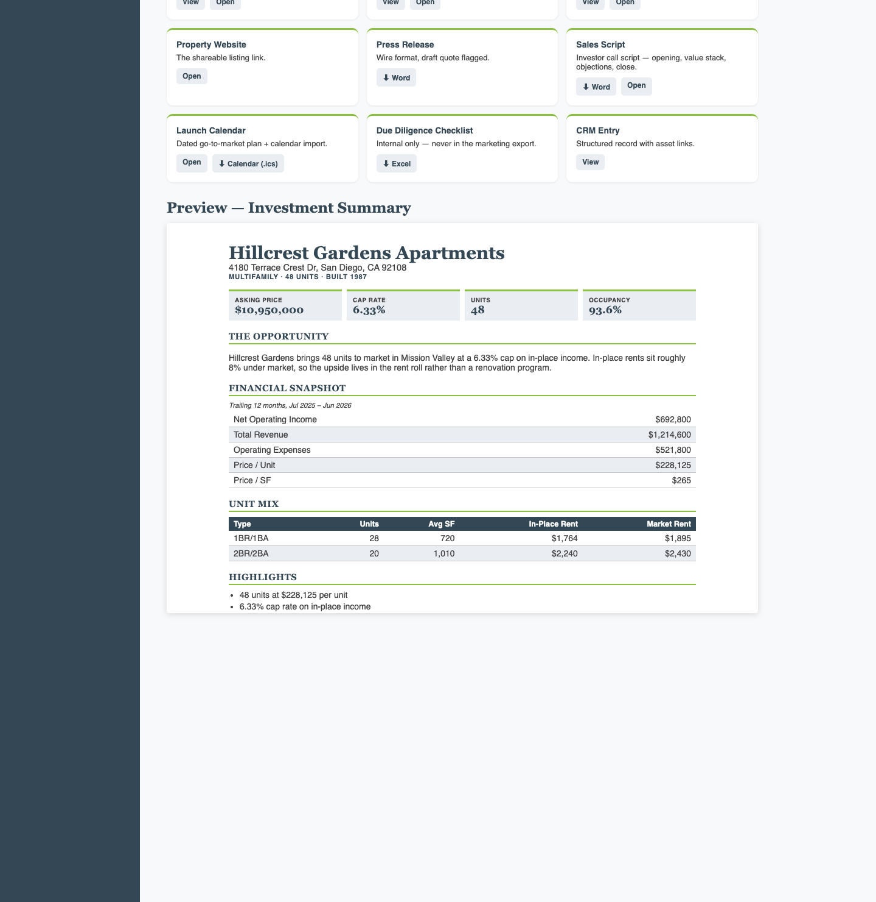
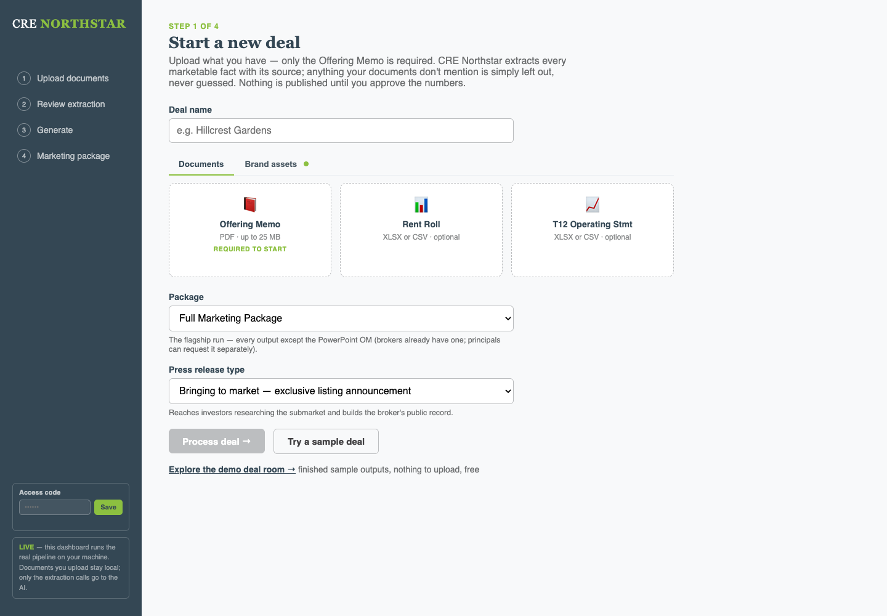
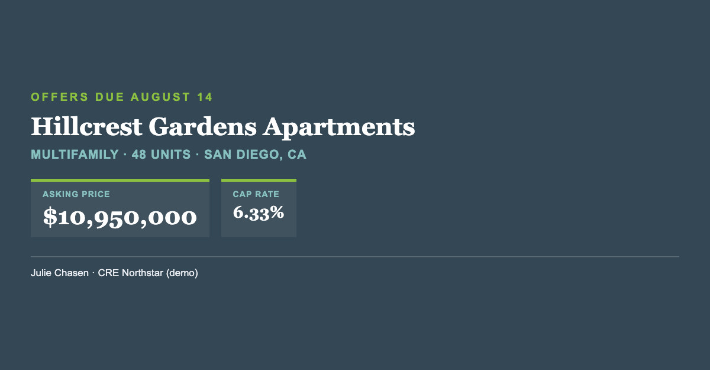

# CRE Northstar

An AI deal-marketing pipeline for commercial real estate brokers. Upload an Offering Memo (plus an optional Rent Roll and T12), approve the extracted numbers, and get a full marketing package: 12 outputs, generated from facts the broker has signed off on.

Designed and built by [Julie Chasen](https://juliechasen.com).



## What it does

1. **Upload.** Only the Offering Memo is required. Rent roll and T12 are optional.
2. **Review.** Every extracted fact shows its source. The broker approves, edits or rejects each one, lowest-confidence facts first. Anything the documents don't mention is left out, not guessed.
3. **Generate.** Claude writes each output from the approved facts only.
4. **Deal room.** Download or open everything from one page.

| Output | Format |
|---|---|
| Investment Summary | Word + web page |
| Executive Memo | Word |
| LinkedIn announcement + share images (1200×627, 1080×1080, 1080×1920) | Text + JPG |
| Investor email | Text + HTML |
| Email drip sequence (launch to offers due) | Text + HTML |
| LoopNet / Crexi listing copy | Text + HTML |
| Property website | HTML |
| Press release (bringing to market, coming soon, or just sold) | Word |
| Sales script for investor calls | Word + HTML |
| Launch calendar | HTML + .ics |
| Due diligence checklist (internal only) | Excel |
| CRM entry | JSON |





## Try the demo

The demo deal room uses a fictional property (Hillcrest Gardens Apartments). It needs no API key and costs nothing to run.

```bash
cd 02_build
npm install
npm run dashboard
```

Then open http://localhost:4820/#demo.

To run your own deal, copy `02_build/.env.example` to `02_build/.env` and add your Anthropic API key.

## How it's built

- **Node.js pipeline** (`02_build/src/steps/`): extract → review → analyze → generate → render.
- **Claude** via the Anthropic SDK for extraction and writing. Each output has its own agent prompt in [`01_architecture/output/agents/`](01_architecture/output/agents/).
- **JSON Schema validation** (Ajv) on deal facts, rent roll, T12, CRM entry and DD checklist. Schemas live in [`01_architecture/output/schemas/`](01_architecture/output/schemas/).
- **Document rendering**: Word (docx), Excel (xlsx), and LinkedIn images rendered in headless Chrome in the deal's own branding.
- **Local dashboard** (`02_build/src/server.mjs`): a single Node server with an access-code gate on anything that costs money or touches real deal data. The demo deal room stays open.

Architecture notes: [`01_architecture/output/ARCHITECTURE.md`](01_architecture/output/ARCHITECTURE.md).

## Credits

Some architecture patterns are adapted, with attribution, from [ahacker-1/cre-acquisition-orchestrator](https://github.com/ahacker-1/cre-acquisition-orchestrator) (Apache 2.0). See [`01_architecture/output/NOTICE.md`](01_architecture/output/NOTICE.md).
